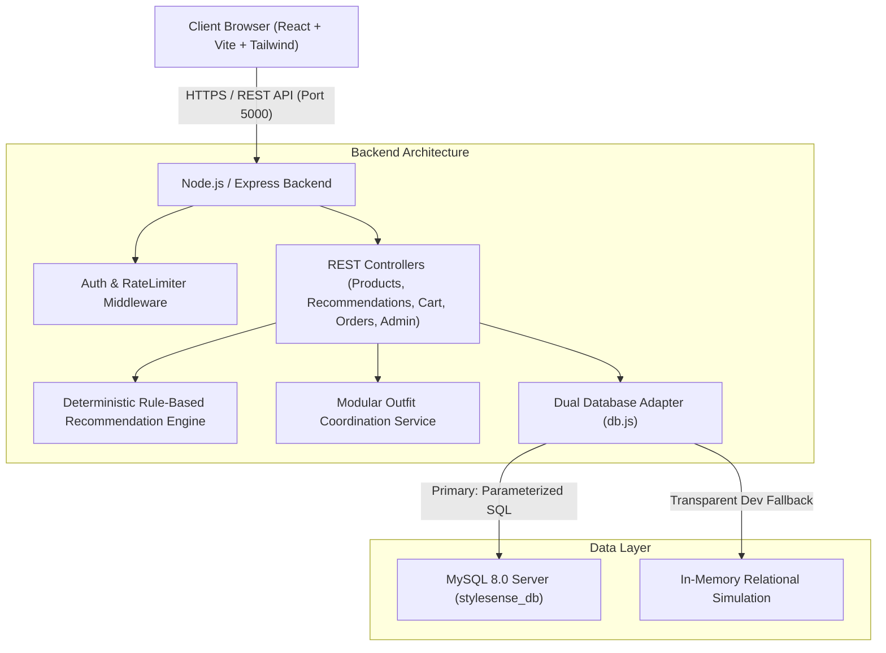
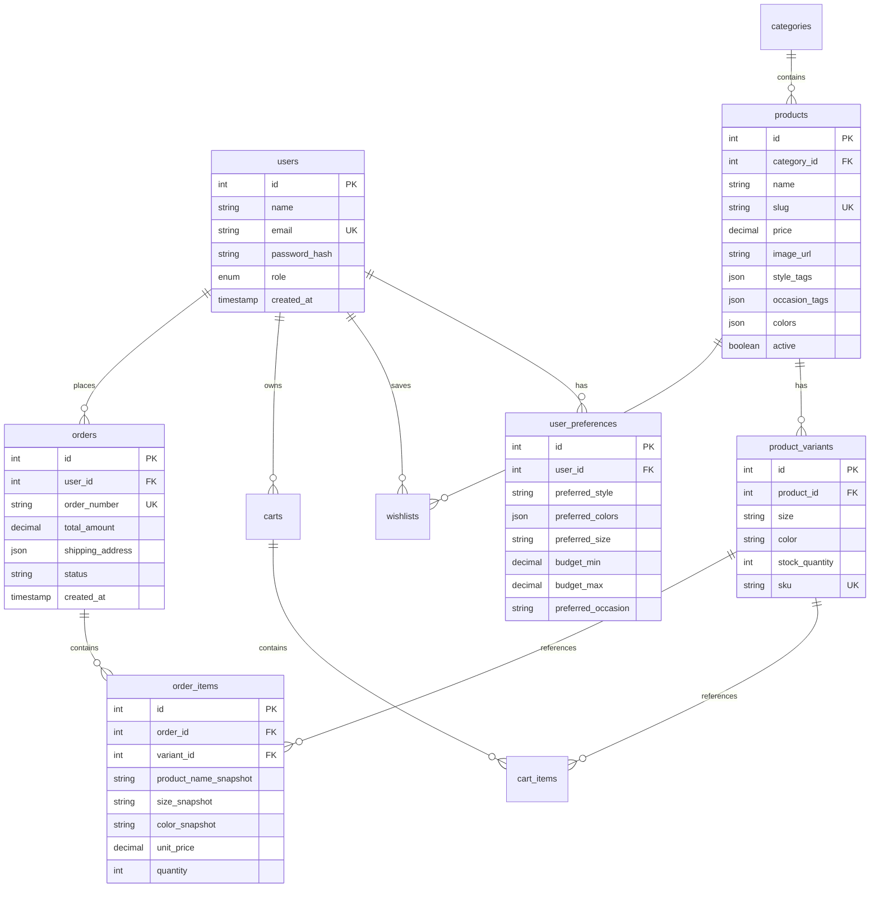

# System Architecture & Technical Specifications — StyleSense AI

## 1. System Architecture Overview

StyleSense AI is architected as a full-stack, modular client-server web application adhering to separation of concerns, transactional integrity, and deterministic AI scoring:

---

## 2. Database Schema & Entity Relationships

The relational schema is normalized into 10 structured tables supporting referential integrity, cascading deletes where appropriate, and historical purchase snapshots:

### Key Relational Features:
- **Historical Snapshots**: The `order_items` table saves `product_name_snapshot`, `size_snapshot`, `color_snapshot`, and `unit_price`. Even if an administrator edits product descriptions or prices later, historical customer invoices remain intact.
- **Atomic Order Placement**: Order creation and stock decrement occur inside a transactional block (`BEGIN TRANSACTION ... COMMIT`), locking inventory rows to eliminate overselling risks under concurrent checkouts.

---

## 3. REST API Overview

| Route | Method | Access | Description |
|---|---|---|---|
| `/api/auth/register` | POST | Public | Register new customer with bcrypt hashing |
| `/api/auth/login` | POST | Public (Rate-limited) | Login, set HttpOnly cookie, return JWT token |
| `/api/auth/logout` | POST | Public | Clear session cookie |
| `/api/auth/me` | GET | Authenticated | Fetch active user profile and saved preferences |
| `/api/products` | GET | Public | Multi-filter search (category, price, size, color, occasion) |
| `/api/products/:id` | GET | Public | Detailed garment view, variant matrix, related items |
| `/api/categories` | GET | Public | List departments with active product count |
| `/api/recommendations` | POST | Dual (Public / Auth) | Execute 100-point rubric; persist preferences if logged in |
| `/api/outfits` | POST | Public | Assemble 5-piece cohesive outfit with budget check |
| `/api/outfits/replace`| POST | Public | Retrieve compatible garment replacements for a slot |
| `/api/preferences` | GET/PUT| Authenticated | View or update saved style preferences |
| `/api/wishlist` | GET/POST| Authenticated | Manage saved wishlist archive |
| `/api/cart` | GET | Authenticated | Retrieve persistent shopping bag with authoritative total |
| `/api/cart/items` | POST/PATCH/DEL| Authenticated | Mutate cart items with live stock verification |
| `/api/orders` | POST/GET| Authenticated | Atomic transacted order placement; view order history |
| `/api/admin/summary` | GET | Admin Only | Catalog metrics, low-stock count, revenue |
| `/api/admin/products`| POST/PUT| Admin Only | Create or edit catalog products and variants |
| `/api/admin/orders` | GET/PATCH| Admin Only | View customer orders and transition fulfillment status |

---

## 4. Authentication & Security Architecture

1. **Password Encryption**: All passwords undergo bcrypt salting and hashing with 10 rounds prior to persistence. Plain-text passwords are never logged or stored.
2. **Dual-Token Storage (HttpOnly Cookies & Headers)**: Supports standard browser sessions via HttpOnly `stylesense_token` cookies with `SameSite=lax` while allowing API testing tools via `Authorization: Bearer <token>`.
3. **Server-Enforced Authorization**: Non-admin users attempting to invoke any `/api/admin/*` endpoint are blocked on the server by the `requireAdmin` middleware, returning `403 Forbidden` regardless of client state.
4. **Order Ownership Enforcement**: Every call to `/api/orders/:id` verifies that `order.user_id === req.user.id` or `req.user.role === 'admin'`. Cross-user inspection is rejected.
5. **CORS Restriction**: CORS is restricted to the configured client origin (`http://localhost:5173`) with explicit allowed headers and methods.
